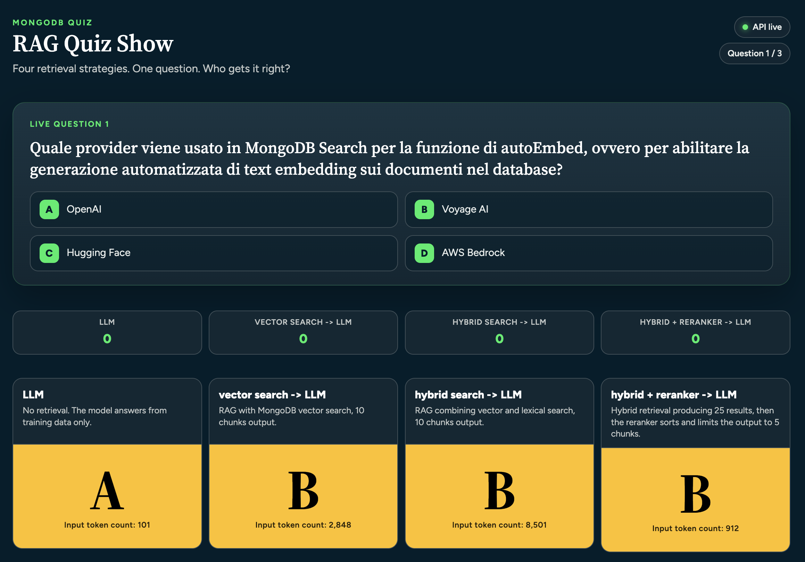
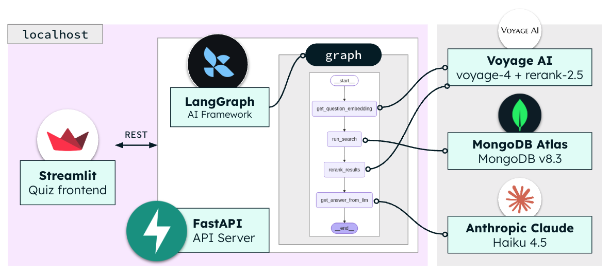

# MongoDB + Voyage AI + LangGraph RAG Demo





This hands-on workshop demonstrates how to build a robust Retrieval-Augmented Generation (RAG) pipeline using MongoDB Search and Voyage AI. The project features a FastAPI and LangGraph backend that loads and indexes MongoDB documentation for both vector and full-text search. To visualize the impact of these search architectures, the repository includes an interactive, quiz-show-style frontend. This UI allows you to compare vector, hybrid, and hybrid-reranked retrieval methods side-by-side, illustrating the context fed to the LLM in each of the three RAG scenarios.

I hope this helps in providing a starting point for further experimentation in your own projects.

> Please note that MongoDB version 8.3 or greater is required to run hybrid search with $scoreFusion.

## What each folder does

| Folder | Role |
| --- | --- |
| `00_chunked_docs` | Pre-chunked NDJSON documents ready to load into MongoDB |
| `01_build_mongodb_kb` | Notebook that embeds documents and creates search indexes |
| `02_app_backend` | FastAPI RAG API (LangGraph pipeline + healthcheck) |
| `03_bruno` | Bruno workspace for calling the API |
| `04_app_frontend` | Streamlit quiz that races four retrieval setups against MongoDB Search questions |

## Prerequisites

- Python 3.13 (the knowledge-base notebook was developed and tested on 3.13)
- A MongoDB deployment with **MongoDB Search** and **MongoDB Vector Search** (Atlas, local Atlas, or self-managed with Search)
- A [Voyage AI](https://www.voyageai.com/) API key
- An LLM backend (the RAG API supports **either** Anthropic or a local LM Studio server; see [Run the RAG API](#3-run-the-rag-api-02_app_backend)):
  - **Anthropic** (default): Claude Haiku 4.5 — set `ANTHROPIC_API_KEY` and `ANTHROPIC_API_URL` in `02_app_backend/.env`
  - **LM Studio** (optional, local): OpenAI-compatible server at `http://localhost:1234/v1` — set `use_local_llm = True` in `02_app_backend/config/config.py`

Install Python dependencies from the repo root:

```bash
python3 -m venv .venv
source .venv/bin/activate
pip install -r requirements.txt
```

## 1. Load the knowledge base (`00_chunked_docs`)

The folder contains NDJSON files (one JSON document per line) chunked from MongoDB documentation about **search** and **vector search**. Recommended target namespace:

- Database: `test_voyage_rag`
- Collection: `mongodb_search_kb`

Create the collection, then import both files with [`mongoimport`](https://www.mongodb.com/docs/database-tools/mongoimport/) or Compass (**Add data → Import JSON file**):

```bash
mongoimport --uri "$MONGO_CONN_STR" \
  --db test_voyage_rag \
  --collection mongodb_search_kb \
  --file 00_chunked_docs/search.ndjson

mongoimport --uri "$MONGO_CONN_STR" \
  --db test_voyage_rag \
  --collection mongodb_search_kb \
  --file 00_chunked_docs/vector-search.ndjson
```

Each document includes `filename`, `chunk_no`, `file_relative_path`, and `content`. The unique upsert key used later is `(file_relative_path, chunk_no)`.

## 2. Embed and index (`01_build_mongodb_kb`)

Open `01_build_mongodb_kb/01_build_mongodb_kb.ipynb` and run it end to end. The notebook:

1. Prompts for the MongoDB connection string and Voyage AI API key
2. Creates a unique index on `(file_relative_path, chunk_no)` so documents can be upserted on re-runs
3. Computes **Voyage 4** embeddings (`voyage-4`, 1024 dimensions, FLOAT32 binary) for chunks missing `voyage4-float`
4. Creates the MongoDB Search indexes used by the API:
   - Vector: `test_voyage_rag_vector` on `voyage4-float`
   - Full-text: `test_voyage_rag_fulltext` on `content`
5. Runs a sample hybrid search (`$rankFusion`) as a sanity check

Wait until both search indexes are **READY** in Compass (or Atlas) before querying. Index builds can take a minute after the notebook cells that create them.

The notebook also documents its own extra packages:

```bash
pip install pymongo==4.17.0 voyageai==0.3.7
```

## 3. Run the RAG API (`02_app_backend`)

The backend is a FastAPI service. A LangGraph graph embeds the question (Voyage), retrieves chunks from MongoDB (vector or hybrid), optionally reranks with Voyage (`rerank-2.5`), then asks the LLM for a multiple-choice answer (`A`–`D`).

### LLM providers

Generation can use **either** Anthropic’s API **or** a local [LM Studio](https://lmstudio.ai/) server. The switch is `use_local_llm` in `02_app_backend/config/config.py` (default `False` = Anthropic).

| Provider | How to enable | Model (in `config.py`) |
| --- | --- | --- |
| **Anthropic** | `use_local_llm = False` (default) | Claude Haiku 4.5 (`claude-haiku-4-5`) |
| **LM Studio** | `use_local_llm = True` | `google/gemma-4-e4b` via the OpenAI-compatible API at `http://localhost:1234/v1` |

LM Studio host, model name, and dummy API key are hardcoded (`lmstudio_base_url`, `lmstudio_model`, `lmstudio_api_key`). If you use LM Studio, start it with a model loaded and the local server enabled before starting this API, and change those values if your model name or port differs. Anthropic credentials in `.env` are ignored while `use_local_llm` is `True`.

### Environment

Create `02_app_backend/.env`. The backend loads it at startup (`python-dotenv`).

**Always required** (MongoDB retrieval and Voyage embeddings / reranking):

```bash
MONGO_CONN_STR=<your MongoDB connection string>
VOYAGEAI_API_KEY=<your Voyage AI API key>
```

**Required when using Anthropic** (`use_local_llm = False`):

```bash
ANTHROPIC_API_KEY=<your Anthropic API key>
ANTHROPIC_API_URL=<Anthropic API base URL>
```

- `ANTHROPIC_API_KEY` authenticates the Anthropic chat client. It is also sent as the `api-key` request header (alongside the hardcoded `anthropic-version` header).
- `ANTHROPIC_API_URL` is the Anthropic-compatible **base URL** passed to the client. Use Anthropic’s public API endpoint, or your gateway/proxy URL if you reach Anthropic through one.

A complete `.env` for the default Anthropic path:

```bash
MONGO_CONN_STR=<your MongoDB connection string>
VOYAGEAI_API_KEY=<your Voyage AI API key>
ANTHROPIC_API_KEY=<your Anthropic API key>
ANTHROPIC_API_URL=<Anthropic API base URL>
```

With LM Studio you still need `MONGO_CONN_STR` and `VOYAGEAI_API_KEY`; you can omit the `ANTHROPIC_*` variables.

Database, collection, and index names are hardcoded in `02_app_backend/config/config.py` to match the recommended namespace (`test_voyage_rag.mongodb_search_kb`).

### Start the server

```bash
cd 02_app_backend
bash run_server.bash
```

That runs:

```bash
fastapi run main.py --port 8080 --host 127.0.0.1
```

The API listens on `http://localhost:8080`. Interactive docs: `http://localhost:8080/docs`.

### Endpoints

- `GET /healthcheck` — basic monitoring; returns `{"status":"OK"}`
- `POST /answer_question` — runs the RAG pipeline

Request body:

```json
{
  "question": "<multiple-choice prompt>",
  "use_rag": true,
  "use_hybrid": false,
  "use_reranker": true
}
```

Response:

```json
{
  "operation_id": "<uuid>",
  "llm_answer": "A",
  "input_tokens": 75,
  "reference_docs": ["<retrieved chunk>", "..."]
}
```

`input_tokens` is the integer number of tokens sent to the LLM for that request.

### Pipeline modes

The caller selects the retrieval path with three booleans:

| Mode | `use_rag` | `use_hybrid` | `use_reranker` |
| --- | --- | --- | --- |
| LLM only | `false` | `false` | `false` |
| Vector search only | `true` | `false` | `false` |
| Hybrid search | `true` | `true` | `false` |
| Vector search + reranker | `true` | `false` | `true` |
| Hybrid search + reranker | `true` | `true` | `true` |

- **LLM only** skips retrieval; the model answers from its training data.
- **Vector search** uses MongoDB Vector Search and returns up to 10 chunks.
- **Hybrid search** fuses vector and lexical results with `$rankFusion` (equal weights), still capped at 10 chunks.
- **Reranker** takes the retrieved chunks and keeps the top 5 after Voyage reranking.

## 4. Test the API (`03_bruno`)

Open the Bruno workspace at `03_bruno/Voyage Workshop API` (collection file `opencollection.yml`). The **Answer Question** request posts to `http://localhost:8080/answer_question` with a sample MongoDB Search multiple-choice question and flags for vector search plus reranking. Adjust `use_rag`, `use_hybrid`, and `use_reranker` to exercise the other modes.

## 5. Quiz show frontend (`04_app_frontend`)

Streamlit app that asks MongoDB Search questions and races **four** setups against each other:

1. LLM only (no retrieval)
2. Vector search → LLM
3. Hybrid search → LLM
4. Hybrid search + reranker → LLM

Each contestant calls `/answer_question` in parallel. Scores are tracked across questions; you can inspect the retrieved chunks per contestant. The quiz also shows each contestant’s `input_tokens` count directly below their answer.

Start it after the API is up:

```bash
cd 04_app_frontend
bash run_streamlit.bash
```

That runs:

```bash
streamlit run app.py --client.toolbarMode "viewer" --browser.gatherUsageStats false
```

By default the UI talks to `http://localhost:8080`. Override with:

```bash
export API_BASE_URL=http://localhost:8080
```

The hero banner uses `/healthcheck` to show whether the backend is reachable.

## Suggested run order

1. Import `00_chunked_docs/*.ndjson` into `test_voyage_rag.mongodb_search_kb`
2. Run `01_build_mongodb_kb/01_build_mongodb_kb.ipynb` and wait for indexes to become READY
3. Add `02_app_backend/.env` (include `ANTHROPIC_API_KEY` and `ANTHROPIC_API_URL` unless you switched to LM Studio) and start the API
4. Hit `/healthcheck` or the Bruno collection
5. Start the Streamlit quiz and compare retrieval quality
